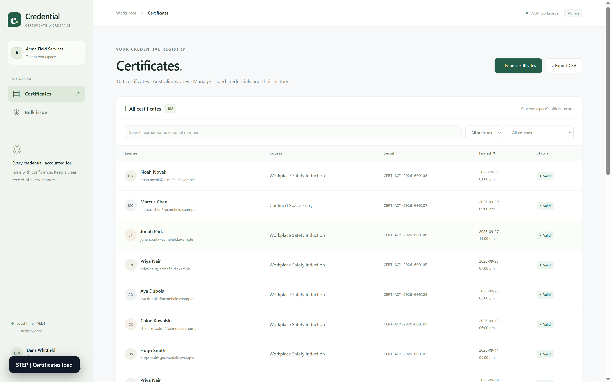
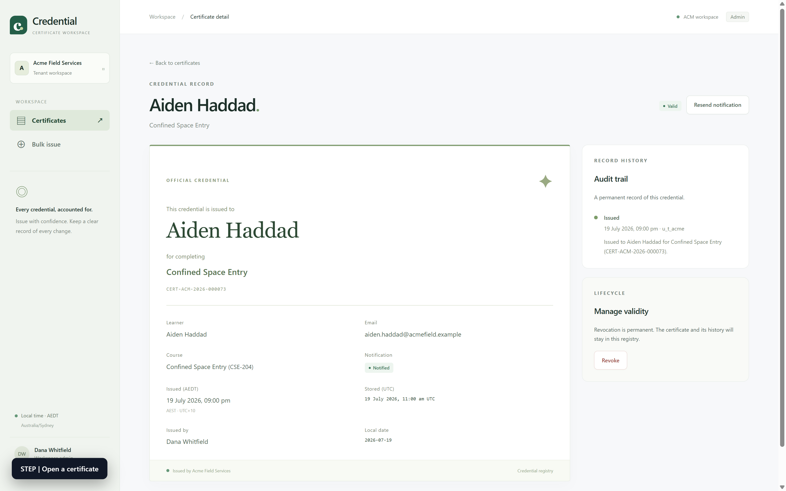
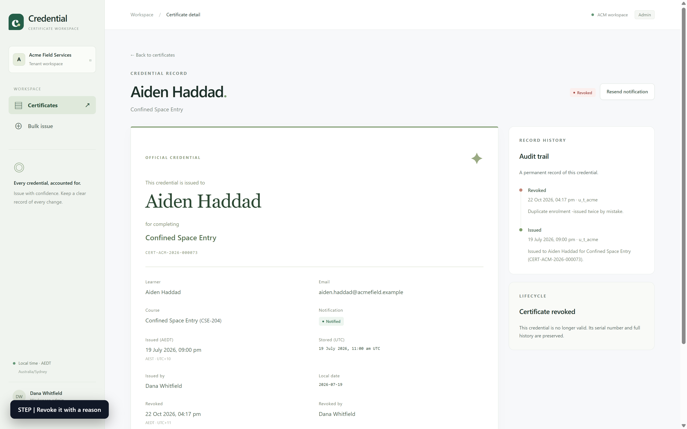
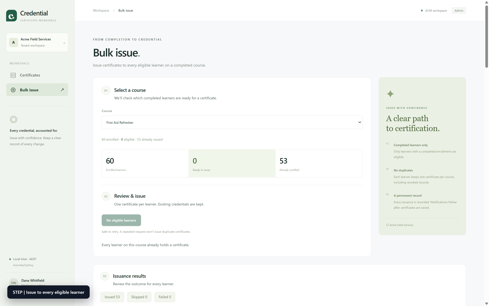

# Certificate Console

Internal admin console for a multi-tenant corporate training platform. Tenant admins review completed
courses, issue completion certificates in bulk, revoke them, and export the result.

**One database per tenant.** The control database holds tenants, users and sessions; each tenant's
courses, learners, enrollments, certificates and audit trail live in their own SQLite file, so a
forgotten `WHERE` clause cannot reach another tenant's data.

---

## Quick start

Choose either option from the repository directory.

### Option 1: Python runner

Requires **Python 3.11+** with `venv`/`pip` and **Node 22 LTS with npm**.

```bash
python run.py
```

First run creates `.venv`, installs backend/frontend dependencies and seeds an empty demo workspace.
Wait for `[run] READY`, then open **http://127.0.0.1:5173**. The API runs on port 8000.
Keep the terminal open; **Ctrl+C stops both servers**. Existing demo data is preserved on restart.

To build the frontend and serve everything on one port instead:

```bash
python run.py --prod
```

Open **http://127.0.0.1:8000**. Use `--port` and `--web-port` for alternate ports. Setup stages have
visible output and a 180-second timeout (`--setup-timeout` changes it). `--no-bootstrap` is available
only when the active Python environment and frontend dependencies are already installed.

### Option 2: Docker Compose

Requires **Docker Engine/Desktop with Docker Compose**. Host Python and Node are not needed.

```bash
docker compose up --build -d --wait
```

Open **http://127.0.0.1:8000**. To inspect logs or stop the container:

```bash
docker compose logs -f
docker compose down
```

Data is stored in `./data` and survives container recreation. Copy `.env.example` to `.env` to
customize the host port or data folder. Both options bind to loopback by default. The two options
share port 8000 by default, so stop one before starting the other or choose different ports.

For verified Linux setup, optional package mirrors and SSH forwarding, see
[Startup instructions](docs/STARTUP.md). To deliberately reset native demo records, run
`python run.py --seed`; normal startup never resets populated databases.

## Recorded walkthrough

The supplied MP4 below is **1600 × 1000 H.264**, approximately **62 seconds**.

<video controls playsinline preload="metadata" width="960" poster="docs/demo/demo-walkthrough-poster.png" src="docs/demo/demo-walkthrough.mp4"></video>

[Watch or download the walkthrough MP4](docs/demo/demo-walkthrough.mp4)

### Make a new recording

Recording additionally requires **FFmpeg** on PATH and Playwright with Chromium in your active
Python environment. Install the test dependencies once (prefer a virtualenv):

```bash
python -m pip install -r requirements.txt playwright
python -m playwright install chromium
```

Then run this command from the repository root:

```bash
python scripts/record_walkthrough.py
```

It builds the SPA, runs the asserted walkthrough against fresh temporary databases at 1600 × 1000,
records at the full viewport resolution, and encodes H.264 MP4 with CRF 18 and fast-start playback.
It writes `docs/demo/demo-walkthrough.mp4`, its poster, and a step index. Original capture files remain
under `e2e/artifacts/recording-*`. Existing demo databases are unaffected.

To watch Chromium during recording or change the pacing:

```bash
python scripts/record_walkthrough.py --headed --slow-ms 1200 --step-ms 2000
```

## Screenshots

### Certificate registry

Search, filter and browse the tenant's certificate records.



### Certificate detail

Review the credential, learner information and issuance history.



### Revocation and audit trail

Revoke a certificate with a reason while preserving its history.



### Bulk issuance

Review course eligibility and the results of issuing certificates in bulk.



## Demo accounts

Sign in by picking a tenant, then an account. There is no password — this is a demo console.

| Tenant | Timezone | Accounts |
| --- | --- | --- |
| Acme Field Services | `Australia/Sydney` | Dana Whitfield (admin), Alex Chen (viewer) |
| Northwind Logistics | `Australia/Perth` | Marcus Bell (admin) |
| Meridian Health Group | `Asia/Singapore` | Wei Ling Tan (admin) |

The tenant is bound to the session. There is no tenant switcher inside the console; sign out to change
tenants.

## Demo path

1. Sign in as **Acme / Dana Whitfield** — the list shows certificates dated in Sydney time.
2. Search by learner name, then by a serial fragment; sort columns; page forward.
3. Open a certificate — the issued date shows `AEDT · UTC+11` (January) or `AEST · UTC+10` (July),
   alongside the raw UTC value.
4. **Revoke** it with a reason; the status flips and the audit trail gains a second entry.
5. **Bulk issue** a course — eligibility counts, per-learner issued/skipped outcomes, then
   **Simulate network retry**: the replay banner appears and nothing is issued twice.
6. **Export CSV** — the file honours the active filter and its row count matches the list.
7. Sign out, sign in as **Northwind** — different certificates, `Australia/Perth`, no crossover.

## Tests

```bash
python -m pytest tests        # API, startup, isolation, export and regression checks
E2E_HEADED=1 python -m pytest e2e -s   # labelled walkthrough with screenshots + video
python -m pytest e2e          # headless, CI
```

`e2e` needs `frontend/dist` (`cd frontend && npm run build`). It seeds a throwaway database, starts
uvicorn on an ephemeral port, and injects an on-screen label for every step before asserting it.
Artefacts land in `e2e/artifacts/`.

`sh check.sh` is the gate: compile, API tests, frontend typecheck.

## Layout

```
app/
  main.py        application factory, SPA mount
  db.py          control database + one database per tenant
  schema_control.sql / schema_tenant.sql
  seed.py        deterministic demo data
  auth.py        login, logout, session, tenant resolution
  timezones.py   IANA-zone rendering, local dates, zone labels
  certs/         repository, service (issuance, revocation), router
frontend/        React + TypeScript + Vite
e2e/             Playwright walkthrough
docs/PLAN.md     decision record (D1–D11)
docs/IMPLEMENTATION.md  architecture, schema, API
run.py           single entrypoint
```

## Known limitations

- No passwords and no SSO: the login page is a demo affordance.
- The notifier is a stub — it records delivery instead of sending email, and revocation does not notify.
- Bulk issue is synchronous with a 1,000-learner cap per request. Above that the answer is a job, not a
  bigger transaction.
- Revocation is terminal; there is no reinstate or re-issue (a retake cannot be certified separately).
- CSV export streams, but the list endpoint uses offset pagination, which degrades on very deep pages.
